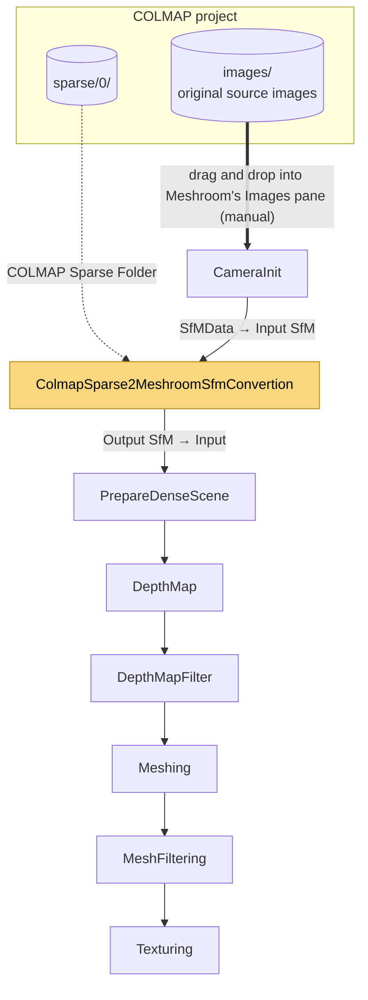
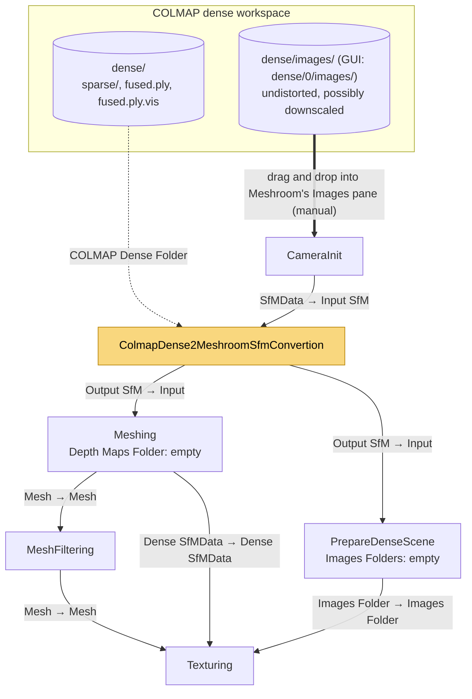

# COLMAP to Meshroom nodes

> [!IMPORTANT]
> **I coded this with AI.**
> **I am no graphics programmer.**
> **Use at your own peril.**
> **The nodes work and geometries seem more detailed, yet, I did not perform (extensive) quantitative testing.**


Two Meshroom nodes that bring a [COLMAP](https://colmap.github.io/) reconstruction into
[Meshroom](https://alicevision.org/#meshroom), so you can use COLMAP for the parts it does well and
Meshroom/AliceVision for the rest:

| Node | Input from COLMAP | Replaces in Meshroom | Typical use |
|---|---|---|---|
| **ColmapSparse2MeshroomSfmConvertion** | sparse model (`sparse/0`: cameras, images, points3D) | FeatureExtraction, FeatureMatching, StructureFromMotion | COLMAP registers your images better than Meshroom; Meshroom does the dense reconstruction and texturing |
| **ColmapDense2MeshroomSfmConvertion** | dense workspace (`dense/`: undistorted model and `fused.ply`) | the above **and** DepthMap, DepthMapFilter | COLMAP computes the dense point cloud; Meshroom builds and textures the mesh |

Both nodes write an AliceVision SfMData file (`.sfm`, json), the format Meshroom passes between its nodes, so the
rest of the Meshroom pipeline works as usual. Both can also run as plain Python scripts, outside of Meshroom.

---

## Contents

1. [Installation](#1-installation)
2. [Preparing the COLMAP data](#2-preparing-the-colmap-data)
3. [Sparse node: COLMAP SfM, Meshroom dense pipeline](#3-sparse-node-colmap-sfm-meshroom-dense-pipeline)
4. [Dense node: COLMAP point cloud, Meshroom mesh and texture](#4-dense-node-colmap-point-cloud-meshroom-mesh-and-texture)
5. [Command line usage](#5-command-line-usage)
6. [Python usage](#6-python-usage)
7. [How the conversion works](#7-how-the-conversion-works)
8. [Code structure](#8-code-structure)
9. [Troubleshooting](#9-troubleshooting)
10. [Limitations](#10-limitations)
11. [Tests](#11-tests)

---

## 1. Installation

### Requirements

- **Meshroom 2023.3 or newer** (SfMData version 1.2.8 or newer). Developed and tested with Meshroom 2025.1.
- **COLMAP**, any recent version (3.x; the rig models of COLMAP 3.12+ are supported).
- No Python packages: only the Python standard library is used, so the nodes run with the Python bundled in
  Meshroom.

### Files

```
colmap/
    __init__.py                                (empty file, makes the folder a Python package)
    ColmapSfmBase.py                           shared code, required by both nodes
    ColmapSparse2MeshroomSfmConvertions.py     sparse node
    ColmapDense2MeshroomSfmConvertions.py      dense node
    README.md                                  this file
    tests/                                     tests (not needed to run the nodes)
```

Each node only needs `ColmapSfmBase.py` next to it: you can install only one of them.

### Option A: precompiled Meshroom release

Copy the `colmap` folder into the nodes folder of Meshroom:

```
Meshroom-<version>/lib/meshroom/nodes/colmap/
```

### Option B: separate nodes folder

Put the `colmap` folder in a folder of your own (e.g. `my_nodes/colmap/`) and point `MESHROOM_NODES_PATH` to
the parent folder before starting Meshroom:

```bash
export MESHROOM_NODES_PATH=/path/to/my_nodes          # Linux / macOS
set MESHROOM_NODES_PATH=C:\path\to\my_nodes           # Windows (cmd)
```

### Check

Restart Meshroom. The two nodes appear in the node menu (right click in the graph editor, or Tab) under the
**Colmap** category.

At startup, Meshroom logs `No class defined in plugin: colmap.ColmapSfmBase`. This is expected: Meshroom
inspects every file of the folder for nodes, and the shared file has none.

---

## 2. Preparing the COLMAP data

### Sparse reconstruction (for both nodes)

With the COLMAP GUI (*Reconstruction > Automatic reconstruction*, or the step-by-step menus) or on the command
line:

```bash
colmap feature_extractor --database_path project/database.db --image_path project/images
colmap exhaustive_matcher --database_path project/database.db
colmap mapper --database_path project/database.db --image_path project/images --output_path project/sparse
```

which gives:

```
project/
    images/              your images
    database.db
    sparse/0/            the sparse model: cameras, images, points3D (.bin, or .txt if exported as text)
```

If COLMAP finds several unconnected models (`sparse/0`, `sparse/1`, ...), convert the one you want: the nodes
convert one model at a time.

### Dense reconstruction (for the dense node)

```bash
colmap image_undistorter --image_path project/images --input_path project/sparse/0 --output_path project/dense
colmap patch_match_stereo --workspace_path project/dense
colmap stereo_fusion --workspace_path project/dense --output_path project/dense/fused.ply
```

which gives the dense workspace:

```
project/dense/
    images/              undistorted (possibly downscaled) images: the dense node needs these, not the originals
    sparse/              undistorted model (PINHOLE cameras): cameras and poses are read from it
    stereo/              depth and normal maps (not used)
    fused.ply            fused point cloud
    fused.ply.vis        for each fused point, the images it was fused from
```

The COLMAP GUI's automatic reconstruction creates the same layout, as `dense/0/`.

The fused points refer to the **undistorted** images, which may also be downscaled or cropped. That's why the
dense node reads the undistorted model in `dense/sparse`, not `sparse/0`, and why Meshroom must use the images of
`dense/images` (`dense/0/images` with the GUI), while the sparse node uses the original source images.

---

## 3. Sparse node: COLMAP SfM, Meshroom dense pipeline

**ColmapSparse2MeshroomSfmConvertion** replaces Meshroom's structure from motion by COLMAP's. Meshroom then computes
the depth maps, the mesh and the texture.

> [!IMPORTANT]
> **Use your original source images, and add them to Meshroom yourself.** Drag the folder of original photos
> that the COLMAP sparse reconstruction was run on (e.g. `project/images`) from your file explorer into
> Meshroom's **Images** pane, which fills CameraInit. The node doesn't do it for you: it only reads the COLMAP
> model, and matches its images to the CameraInit views by file name. Unlike the dense node, no undistorted
> copies are needed: the sparse model keeps COLMAP's distortion, and PrepareDenseScene undistorts the originals
> itself. Keep the original file names, so the matching works.

### Graph



Solid arrows are node connections, dotted arrows are folders set in a node's attributes, and the thick arrow is
the manual step of adding the COLMAP images to Meshroom. The highlighted node replaces FeatureExtraction,
ImageMatching, FeatureMatching and StructureFromMotion; the connections after PrepareDenseScene are those of
Meshroom's default pipeline.

Starting from Meshroom's default photogrammetry pipeline: delete FeatureExtraction, ImageMatching,
FeatureMatching and StructureFromMotion, add the node, and connect:

| From (output) | To (input) |
|---|---|
| CameraInit **SfMData** | ColmapSparse2MeshroomSfmConvertion **Input SfM** |
| ColmapSparse2MeshroomSfmConvertion **Output SfM** | PrepareDenseScene **Input** |
| ColmapSparse2MeshroomSfmConvertion **Output SfM** | Meshing **Input** (if Meshing was connected to StructureFromMotion) |

The rest of the pipeline stays as it is.

### Settings

- **CameraInit**: drag your **original source images** (the folder COLMAP's sparse reconstruction was run on,
  e.g. `project/images`) into Meshroom's **Images** pane. This is a manual step; see the note above.
- **ColmapSparse2MeshroomSfmConvertion**: set **COLMAP Sparse Folder** to the model, e.g. `project/sparse/0`.
  A parent folder also works (`project`, `project/sparse`): the node looks for `0`, `sparse/0` and `sparse` in it.

### Attributes

| Attribute | Name | Default | Description |
|---|---|---|---|
| COLMAP Sparse Folder | `input` | | COLMAP model folder (or a parent of it). Binary (`.bin`) and text (`.txt`) models are supported. |
| Input SfM | `inputSfm` | | SfMData of CameraInit. Views are matched to COLMAP images by file name, keeping Meshroom's view ids, image paths, metadata, sensor size and serial number. **Recommended.** |
| Image Folder | `imageFolder` | | Folder of the images used by COLMAP. Only used without Input SfM: the views are then created from the COLMAP image names. |
| Include Landmarks | `includeLandmarks` | on | Export the COLMAP 3D points as landmarks. DepthMap uses them to estimate the depth range of each view. |
| Verbose Level | `verboseLevel` | info | Log level. |
| Output SfM | `outputSfm` | `sfmdata.sfm` | Converted SfMData. |

**Why use Input SfM:** the output then uses the SfMData version of your Meshroom (without it, version 1.2.12,
which Meshroom versions older than 2025.1 refuse to load). Meshroom also recognizes the views as its own, with
their metadata.

---

## 4. Dense node: COLMAP point cloud, Meshroom mesh and texture

**ColmapDense2MeshroomSfmConvertion** converts COLMAP's fused point cloud into an SfMData whose landmarks are the
fused points. Meshing builds the mesh directly from these points, so DepthMap and DepthMapFilter, the slowest
part of the Meshroom pipeline, are skipped.

> [!IMPORTANT]
> **The images must come from the COLMAP dense workspace, and you add them to Meshroom yourself.** Drag the
> **`images` folder of the dense workspace** from your file explorer into Meshroom's **Images** pane, which fills
> CameraInit. The node doesn't do it for you. For example:
>
> ```
> C:\Users\marco\Desktop\floortest\dense\0\images      (COLMAP GUI: dense\0\images)
> project/dense/images                                 (command line: dense/images)
> ```
>
> Use these images, **not** your original photos. COLMAP's `image_undistorter` writes undistorted copies there,
> and may also **downscale** them (its maximum image size setting) or crop them. In the floortest project, the
> originals are 5184x3888 and the images in `dense\0\images` are 2400x1799. The fused points and the
> undistorted cameras refer to these copies. They keep the **same file names** as the originals, so with the
> originals the conversion still runs, and Texturing fails later with *Bad image dimension*.

### Graph



Solid arrows are node connections (output → input attribute), dotted arrows are folders set in a node's
attributes, and the thick arrow is the manual step of adding the COLMAP images to Meshroom. The highlighted node
replaces FeatureExtraction, ImageMatching, FeatureMatching, StructureFromMotion,
DepthMap and DepthMapFilter.

| From (output) | To (input) |
|---|---|
| CameraInit **SfMData** | ColmapDense2MeshroomSfmConvertion **Input SfM** |
| ColmapDense2MeshroomSfmConvertion **Output SfM** | Meshing **Input** (SfMData) |
| ColmapDense2MeshroomSfmConvertion **Output SfM** | PrepareDenseScene **Input** (SfMData) |
| Meshing **Mesh** | MeshFiltering **Mesh** |
| MeshFiltering **Mesh** | Texturing **Mesh** |
| Meshing **Dense SfMData** | Texturing **Dense SfMData** |
| PrepareDenseScene **Images Folder** | Texturing **Images Folder** |

Do **not** insert DepthMap or DepthMapFilter: they would compute new depth maps instead of using COLMAP's points.

### Settings (all of them matter)

| Node | Setting | Why |
|---|---|---|
| **CameraInit** | **drag the `dense/images` folder of the COLMAP workspace into Meshroom's Images pane** (manual step), not the original images | the view sizes must match the undistorted COLMAP cameras. With the original images, Texturing fails with *Bad image dimension*. |
| **ColmapDense2MeshroomSfmConvertion** | **COLMAP Dense Folder** = the dense workspace, e.g. `project/dense` (or `dense/0` from the GUI) | |
| **Meshing** | leave **Depth Maps Folder** empty (not connected) | Meshing then builds the mesh from the SfMData landmarks only, i.e. from the fused points. Its own **Max Points** setting (5M by default) still caps the number of points it uses. |
| **PrepareDenseScene** | leave **Images Folders** empty | PrepareDenseScene then reads each image from its view path (`dense/images`). If a folder is listed, it looks there for images with the same file name and may pick the original, full-size photos instead. |
| **Texturing** | **Images Folder** must come from PrepareDenseScene | In Meshroom 2025.1, Texturing only generates textures when Images Folder is set. With it empty, the mesh gets a plain white material. Texturing looks there for images named `<viewId>.<ext>`, which PrepareDenseScene writes; the images of `dense/images` keep their original names, so they can't be used directly. The cameras have no distortion, so PrepareDenseScene only renames and converts the images. |

CameraInit is optional: without it, leave **Input SfM** empty and the views are created from `dense/images`. With
CameraInit (recommended), its images must be the ones you dragged in from `dense/images`.

### Attributes

| Attribute | Name | Default | Description |
|---|---|---|---|
| COLMAP Dense Folder | `input` | | Dense workspace, holding `sparse/`, `images/` and `fused.ply`. |
| Fused Point Cloud | `fusedPly` | `<input>/fused.ply` | Fused point cloud; `<fusedPly>.vis` is read too. |
| Input SfM | `inputSfm` | | SfMData of a CameraInit run on `dense/images`. Views are matched to COLMAP images by file name. |
| Image Folder | `imageFolder` | `<input>/images` | Undistorted images, only used without Input SfM. |
| Max Points | `maxPoints` | 1000000 | Maximum number of exported points, 0 for all. Points are kept evenly through the file. |
| Verbose Level | `verboseLevel` | info | Log level. |
| Output SfM | `outputSfm` | `sfmdata.sfm` | Converted SfMData. |

**About Max Points:** the SfMData is a json file that AliceVision loads slowly and with a lot of memory. Each point
takes several hundred bytes, depending on how many images see it (about 750 bytes with 26 images), so the default
of 1 million points gives files of several hundred MB. Raise it if your machine handles it, and keep Meshing's own
Max Points in mind.

### Variant: texturing COLMAP's own mesh (not tested)

COLMAP can also mesh the fused points (`colmap poisson_mesher` gives `dense/meshed-poisson.ply`). To texture that
mesh instead of Meshroom's: skip Meshing and MeshFiltering, connect the node's **Output SfM** to Texturing
**Dense SfMData**, and set Texturing **Mesh** to `meshed-poisson.ply`. The mesh is in the same coordinates as the
cameras. If your Meshroom version does not read `.ply` meshes, convert it to `.obj` first (e.g. with MeshLab or
Blender).

---

## 5. Command line usage

Both scripts run with any Python 3, without Meshroom. Run them from the `colmap` folder, or anywhere with
`ColmapSfmBase.py` next to the script.

### Sparse

```bash
python3 ColmapSparse2MeshroomSfmConvertions.py <colmap_sparse_folder> <output.sfm> [options]
```

| Option | Description |
|---|---|
| `--inputSfm PATH` | SfMData from Meshroom's CameraInit (recommended) |
| `--imageFolder PATH` | folder of the images used by COLMAP, required if `--inputSfm` is not given |
| `--noLandmarks` | do not export the COLMAP 3D points |

```bash
python3 ColmapSparse2MeshroomSfmConvertions.py project/sparse/0 sfm.sfm --imageFolder project/images
python3 ColmapSparse2MeshroomSfmConvertions.py project sfm.sfm --inputSfm MeshroomCache/CameraInit/<uid>/cameraInit.sfm
```

### Dense

```bash
python3 ColmapDense2MeshroomSfmConvertions.py <colmap_dense_folder> <output.sfm> [options]
```

| Option | Description |
|---|---|
| `--fusedPly PATH` | fused point cloud, `<colmap_dense_folder>/fused.ply` by default (its `.vis` file is required too) |
| `--inputSfm PATH` | SfMData from a Meshroom CameraInit run on `<colmap_dense_folder>/images` |
| `--imageFolder PATH` | folder of the undistorted images, `<colmap_dense_folder>/images` by default |
| `--maxPoints N` | maximum number of exported points, 0 for all (default 1000000) |

```bash
python3 ColmapDense2MeshroomSfmConvertions.py project/dense dense.sfm
python3 ColmapDense2MeshroomSfmConvertions.py project/dense dense.sfm --maxPoints 0 \
    --inputSfm MeshroomCache/CameraInit/<uid>/cameraInit.sfm
```

Both scripts print their progress (model size, skipped images, landmarks) and stop with an error message if the
input is not usable (see [Troubleshooting](#9-troubleshooting)).

---

## 6. Python usage

Put the `colmap` folder on the Python path (or run from it), then:

### Sparse

```python
from ColmapSparse2MeshroomSfmConvertions import SparseSfmConverter, convert, colmap2meshroom

# one call: read, convert, write
convert("project/sparse/0", "sfm.sfm", input_sfm="cameraInit.sfm")
convert("project/sparse/0", "sfm.sfm", image_folder="project/images", include_landmarks=False)

# or with the converter, to inspect or modify the SfMData before writing it
converter = SparseSfmConverter("project/sparse/0", image_folder="project/images")
sfm_data = converter.to_sfm_data()          # dict: version, views, intrinsics, poses, structure
sfm_data = colmap2meshroom("project/sparse/0", image_folder="project/images")   # same, as a function
```

### Dense

```python
from ColmapDense2MeshroomSfmConvertions import DenseSfmConverter, FusedPointCloud, convert

convert("project/dense", "dense.sfm", max_points=500000)

converter = DenseSfmConverter("project/dense", input_sfm="cameraInit.sfm", max_points=0)
num_landmarks = converter.write("dense.sfm")
print(converter.stats)  # observations, of images not exported, invalid, points dropped

# read a fused point cloud: (x, y, z, red, green, blue) and image indices, point by point
cloud = FusedPointCloud("project/dense/fused.ply")
print(cloud.check(), "points")
for point, image_indices in cloud:
    ...
```

### Shared building blocks

```python
from ColmapSfmBase import ColmapModelReader, SfmJson, SfmViewsConverter

# COLMAP reader: dicts of Camera, Image and Point3D namedtuples, keyed by COLMAP id
cameras, images, points3D = ColmapModelReader.read("project/sparse/0")

# cameras only: views, intrinsics and poses, plus which COLMAP image became which view
converter = SfmViewsConverter(cameras, images, image_folder="project/images")
sfm_data = converter.convert()
print(converter.view_ids)  # {colmap_image_id: view_id}
SfmJson.write("cameras.sfm", sfm_data)
```

Every class and function takes an optional `logger` (a `logging.Logger`). By default the module logger is used.

---

## 7. How the conversion works

### Cameras (both nodes)

- **Poses:** COLMAP stores each image's world-to-camera transform `(R, t)` as a quaternion and a translation.
  AliceVision stores the same rotation `R` as a column-major matrix and the camera center `C = -Rᵀ t`. Rig models
  (COLMAP 3.12+) are supported, as `images.bin` stores each image's full pose. Rig constraints are not exported:
  every image gets its own pose.
- **Intrinsics:** every COLMAP camera becomes a `pinhole` intrinsic. The focal length is stored in mm for the
  sensor width: 36 mm by default, or CameraInit's sensor width with Input SfM. `fx ≠ fy` is kept through the pixel
  ratio, and the principal point is kept (stored as an offset from the image center). Up to SfMData 1.2.10,
  `focalLength` is the focal along x; from 1.2.11 it is the focal along y. The version of Input SfM decides.
- **Camera models and distortion:**

  | COLMAP model | AliceVision distortion |
  |---|---|
  | SIMPLE_PINHOLE, PINHOLE | none |
  | SIMPLE_RADIAL | radialk1 |
  | RADIAL | radialk3 (k3 = 0) |
  | OPENCV | brown (k3 = 0) |
  | FULL_OPENCV | brown, only if k4 = k5 = k6 = 0 |
  | OPENCV_FISHEYE | fisheye |
  | SIMPLE_RADIAL_FISHEYE, RADIAL_FISHEYE | fisheye (missing coefficients = 0) |
  | SIMPLE_FISHEYE, FISHEYE | fisheye (all coefficients = 0) |
  | FOV | fisheye1 |

  The dense node only accepts cameras without distortion (the undistorted model is PINHOLE).
- **Views:** with Input SfM, each COLMAP image is matched to a CameraInit view by the longest common path suffix
  of its name. For example, COLMAP's `a/IMG_1.jpg` matches `/photos/a/IMG_1.jpg`. If several views match equally
  well, the image is skipped rather than guessed. Without Input SfM, views get the COLMAP image id as view id and
  `<Image Folder>/<image name>` as path.
- **Skipped images** (logged as warnings): images without a valid pose, images using an unknown camera, and, with
  Input SfM, images not found or ambiguous in the CameraInit views. Only the cameras of the exported images become
  intrinsics.

### Landmarks, sparse node

Every COLMAP 3D point becomes a landmark with its color, observed at its COLMAP keypoints (`featureId` = keypoint
index) in the exported views. Points seen by fewer than 2 exported views are dropped, and so are further
observations of a point in a view that already has one.

### Landmarks, dense node

- Every kept fused point becomes a landmark (`landmarkId` = its index in `fused.ply`) with its color. It is
  observed by the images listed in `fused.ply.vis`, at the projection of the point into each image
  (`featureId` = `landmarkId`, as fused points have no keypoints).
- **Image order:** `fused.ply.vis` refers to images by index. Older COLMAP versions index the registered images in
  model file order, newer ones sorted by image id. The node projects a sample of about 2000 points with both orders
  and keeps the one where the points land in their images. The log says which one was chosen.
- **Invalid observations:** projections behind the camera, or more than 1 pixel outside the image, are dropped. If
  more than 5% are invalid, a warning says that `fused.ply.vis` probably does not match the model.
- **Max Points:** with `N` points and Max Points `M < N`, 1 point out of `ceil(N / M)` is kept, evenly through the
  file.
- **Number format:** to keep large files smaller, pixel coordinates are written to 1/1000 pixel, and coordinates
  with 9 significant digits (exact for the float32 values of `fused.ply`).
- **Streaming:** the point cloud is read and the SfMData written point by point, so memory use doesn't grow with
  the number of points (except inside AliceVision when it later loads the file).

### Output format

Both nodes write the json SfMData format of AliceVision, with every value as a string, like Meshroom itself.
Landmarks have `descType` `unknown`: no AliceVision feature or match files exist for them.

---

## 8. Code structure

```
ColmapSfmBase.py                        shared by both nodes
    ColmapModelReader                   reads COLMAP sparse models (.bin / .txt), standard library only
    SfmJson                             SfMData json conventions; load, write, streamed write
    CameraConverter                     COLMAP camera -> AliceVision intrinsic (and pinhole parameters)
    PoseConverter                       COLMAP pose -> AliceVision pose (and rotation matrix)
    SourceViews                         matches COLMAP image names to CameraInit views
    SfmViewsConverter                   cameras + images -> views, intrinsics, poses, and view_ids
    LandmarkFactory                     builds landmarks and observations (2-view minimum, number format)
    ColmapConversionNode                node mixin: category, shared attributes, log handling

ColmapSparse2MeshroomSfmConvertions.py
    SparseSfmConverter                  read model -> SfmViewsConverter -> landmarks from COLMAP 3D points
    ColmapSparse2MeshroomSfmConvertion  Meshroom node
    colmap2meshroom(), convert()        shortcuts

ColmapDense2MeshroomSfmConvertions.py
    PlyPointReader                      streams the vertices of PLY point clouds
    FusedPointCloud                     fused.ply + fused.ply.vis, checked and read together
    CameraProjection                    projects world points into an undistorted image
    DenseSfmConverter                   read model -> SfmViewsConverter -> image order -> streamed landmarks
    ColmapDense2MeshroomSfmConvertion   Meshroom node
    convert()                           shortcut
```

Data flow, for both nodes:

```
ColmapModelReader.read() -> cameras, images --> SfmViewsConverter --> views, intrinsics, poses
                                                  |  (CameraConverter, PoseConverter, SourceViews)
                                                  +-> view_ids: COLMAP image id -> view id
points (COLMAP 3D points / fused points) + view_ids --> LandmarkFactory --> structure
SfMData --> SfmJson.write() (sparse) / SfmJson.write_streamed() (dense)
```

Design notes:

- **Why a shared file:** both nodes must convert the cameras in exactly the same way. The dense node also needs
  to know which COLMAP image became which view, to attach the fused points to the right views.
  `SfmViewsConverter.view_ids` gives it that without re-reading or re-matching anything.
- **Why a mixin for the nodes:** Meshroom registers every `desc.Node` subclass it finds in a module as a node. A
  shared `desc.Node` base class would show up as an extra, empty node, so `ColmapConversionNode` is a plain class
  combined with `desc.Node` in each node (`class ...(ColmapConversionNode, desc.Node)`).
- **Why no dependencies:** Meshroom's bundled Python has no numpy, plyfile, etc. The COLMAP reader is a
  standard-library port of COLMAP's `read_write_model.py`, and the PLY reader supports the subset COLMAP writes.
- **Why the `tests/` folder has no `__init__.py`:** Meshroom looks for nodes with `pkgutil.iter_modules`, which
  skips folders that aren't packages. Without the file, the tests are never loaded as nodes.

---

## 9. Troubleshooting

| Symptom | Cause | Fix |
|---|---|---|
| Texturing: `Cannot find image file corresponding to the view '<id>' in folder '<folder>'` | Texturing's **Images Folder** points to a folder of images with their original names (e.g. `dense/images`); Texturing looks for `<viewId>.<ext>` there | Connect PrepareDenseScene **Images Folder** to Texturing **Images Folder** (see [section 4](#4-dense-node-colmap-point-cloud-meshroom-mesh-and-texture)) |
| The textured mesh is white / has no texture files | Texturing's **Images Folder** is empty; in Meshroom 2025.1 color mapping is then disabled | Same fix: Images Folder from PrepareDenseScene |
| Texturing: `Bad image dimension for camera` (e.g. expected 2400x1799, real 5184x3888) | Texturing got the original, full-size images instead of the undistorted ones: CameraInit imported the originals, or PrepareDenseScene's **Images Folders** lists the folder of the originals | Clear the images in Meshroom, drag the COLMAP `dense/images` folder into the Images pane, and leave PrepareDenseScene **Images Folders** empty |
| `COLMAP camera <id> (<model>) has distortion: use the undistorted model of the dense workspace` | The dense node was given a workspace whose `sparse/` model has distortion, i.e. not the output of `colmap image_undistorter` | Point **COLMAP Dense Folder** to the dense workspace created by `image_undistorter` |
| `No COLMAP model (cameras.bin or cameras.txt) found in: <path>` | Wrong folder | Point to the model folder (`sparse/0`) or the dense workspace |
| `File not found: .../fused.ply` or `.../fused.ply.vis` | `stereo_fusion` was not run, or wrote elsewhere | Run `colmap stereo_fusion`, or set **Fused Point Cloud** |
| `fused.ply has N points but fused.ply.vis has M` | The two files come from different runs | Re-run `stereo_fusion` |
| `XX% of the observations are invalid: ... probably does not match the COLMAP model` | `fused.ply` was fused from another reconstruction than `dense/sparse` | Re-run `image_undistorter`, `patch_match_stereo` and `stereo_fusion` on the same model |
| `No image of the COLMAP model could be exported` | No image matched (see the warnings before it), typically CameraInit imported other images than COLMAP used | Drag the COLMAP image folder into Meshroom's Images pane: the one COLMAP used for the sparse node, `dense/images` for the dense node |
| Warning `Image <name> not found in the input SfMData (skipping)` | That COLMAP image has no (unambiguous) CameraInit view | Import it in CameraInit; for images with the same file name in several folders, keep the folders in their paths |
| Warning `Image <name> is WxH in the input SfMData but wxh in COLMAP` | The images in CameraInit don't have the size COLMAP's cameras expect: with the dense node, the originals were used instead of the undistorted, downscaled copies in `dense/images`; with the sparse node, COLMAP ran on resized copies of the photos. COLMAP's intrinsics are kept, so they won't match the images | Dense node: drag `dense/images` (`dense/0/images` from the GUI) into Meshroom's Images pane instead. Sparse node: use the images COLMAP's sparse reconstruction was run on |
| `SfMData version 1.2.x is too old` | Meshroom older than 2023.3 | Use Meshroom 2023.3 or newer |
| Meshroom refuses to load the output (version) | Without Input SfM, the file is written as version 1.2.12 (Meshroom 2025.1) | Connect CameraInit to **Input SfM** |
| `COLMAP camera model <model> ... is not supported` | THIN_PRISM_FISHEYE, RAD_TAN_THIN_PRISM_FISHEYE, SIMPLE_DIVISION, DIVISION, EUCM, EQUIRECTANGULAR, or FULL_OPENCV with k4-k6 ≠ 0 | Re-run COLMAP with a supported camera model |
| Startup log: `No class defined in plugin: colmap.ColmapSfmBase` | Expected: the shared file has no node | Nothing to do |
| The nodes don't appear in Meshroom | The folder is not a package, or not where Meshroom looks | Check `__init__.py` and the installation path (section 1), then restart Meshroom |

---

## 10. Limitations

**Both nodes**

- Requires Meshroom 2023.3 or newer (SfMData 1.2.8+). Without Input SfM, the file is written as version 1.2.12
  (Meshroom 2025.1).
- Unsupported COLMAP camera models: THIN_PRISM_FISHEYE, RAD_TAN_THIN_PRISM_FISHEYE, SIMPLE_DIVISION, DIVISION,
  EUCM, EQUIRECTANGULAR, and FULL_OPENCV with rational distortion (k4, k5 or k6 ≠ 0).
- Intrinsics are not rescaled: if COLMAP ran on resized copies of the images, the output is only valid for images
  of that size.
- Pixel coordinates (principal point, observations) are copied as is, without any half-pixel shift.
- Landmarks have descType `unknown` and no AliceVision feature or match files exist for them. Nodes that need
  features or matches (e.g. running StructureFromMotion again on the output) can't use them.
- Rig constraints are not exported. Only one COLMAP model is converted at a time.
- Intrinsics and poses are written unlocked: nodes that refine the SfM may modify them.

**Sparse node**

- The COLMAP text format doesn't support image names with spaces (a COLMAP limitation); the binary format does.

**Dense node**

- Normals (in `fused.ply`) and the depth and normal maps (in `stereo/`) are not used: an SfMData can't store them,
  and Meshing and Texturing don't need them.
- Only PLY files whose first element is `vertex`, without list properties, are read (as written by COLMAP).
- Large point clouds give large SfMData files that AliceVision loads slowly; use Max Points.

---

## 11. Tests

The `tests/` folder holds unit and integration tests for the three files. They use pytest and build mock COLMAP
models, dense workspaces and a fake Meshroom API, so neither COLMAP nor Meshroom is needed.

```bash
python -m pip install pytest
cd colmap
python -m pytest tests -v
```

| File | Covers |
|---|---|
| `tests/conftest.py` | shared fixtures: COLMAP model, PLY and visibility writers, mock sparse and dense scenes, CameraInit SfMData, command line runner, fake Meshroom API |
| `tests/test_ColmapSfmBase.py` | reader, json, camera and pose conversion, view matching, views converter, landmark factory, node mixin |
| `tests/test_ColmapSparse2MeshroomSfmConvertions.py` | sparse conversion end to end, command line, node |
| `tests/test_ColmapDense2MeshroomSfmConvertions.py` | PLY and visibility reading, projection, image order detection, dense conversion end to end, command line, node |
